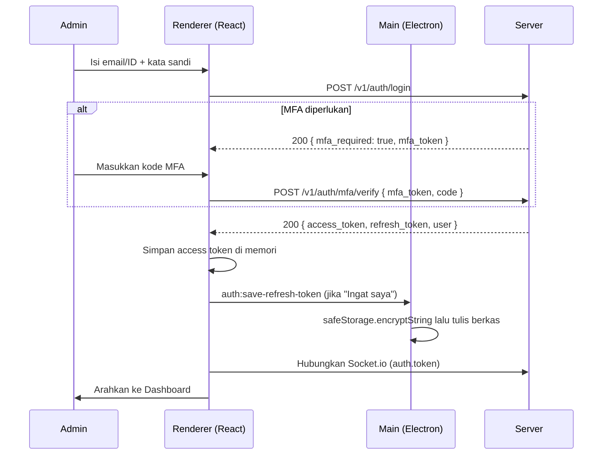
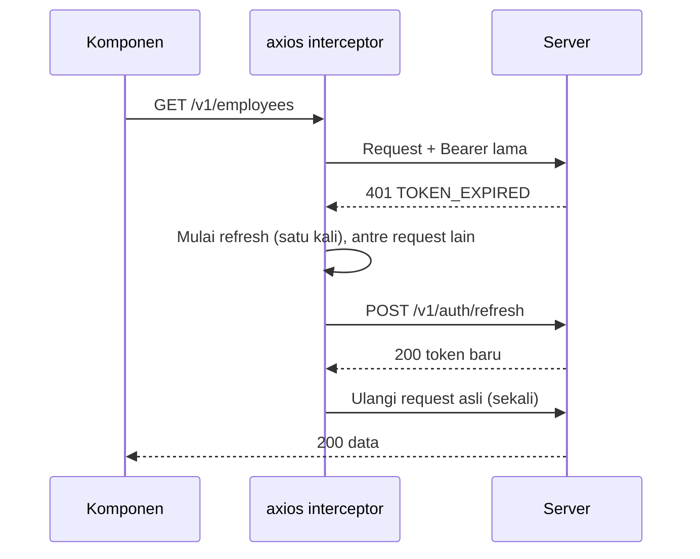

# auth.md: Autentikasi dan Otorisasi Admin Desktop GeoAttend

Spesifikasi autentikasi untuk **Dashboard Admin Desktop** (Electron + React Vite). Dokumen ini selaras dengan `AGENTS.md` (Bagian 5 dan 6). Bagian bertanda **[SINKRONKAN]** adalah usulan kontrak yang harus dikonfirmasi dengan backend; bagian bertanda `[ISI]` harus dilengkapi pemilik repo.

---

## 1. Ringkasan

| Aspek | Keputusan |
|---|---|
| Skema | JWT Bearer: **access token** berumur pendek + **refresh token** berotasi |
| Pengguna | HR Admin, Super Admin, Department Manager, Executive (bukan pegawai lapangan) |
| Faktor tambahan | **MFA wajib** untuk HR Admin dan Super Admin (sesuai PRD) |
| Access token | Disimpan **hanya di memori renderer** |
| Refresh token | Disimpan di main process terenkripsi dengan `safeStorage` |
| Real-time | Token dikirim di handshake Socket.io (`auth`), bukan query string |
| Otorisasi | RBAC ditegakkan **server**; UI hanya menyesuaikan tampilan |
| Device binding | **Tidak berlaku** di admin desktop (hanya untuk aplikasi mobile pegawai) |

---

## 2. Peran dan Hak Akses

| Peran | Cakupan |
|---|---|
| `executive` | Dashboard dan laporan agregat saja; **tanpa** lokasi individual |
| `manager` | Baca dashboard, peta, dan data **departemennya**; persetujuan koreksi tim |
| `hr_admin` | CRUD karyawan, approval, laporan, pengaturan shift dan geofence |
| `super_admin` | Semua hak `hr_admin` + audit log, kebijakan privasi, manajemen peran |

### 2.1 Matriks menu dan aksi

| Fitur | executive | manager | hr_admin | super_admin |
|---|:---:|:---:|:---:|:---:|
| Dashboard (KPI agregat) | Ya | Ya (departemen) | Ya | Ya |
| Live Monitoring (peta individual) | Tidak | Ya (departemen) | Ya | Ya |
| Employees (lihat) | Tidak | Ya (departemen) | Ya | Ya |
| Employees (tambah/ubah/nonaktifkan) | Tidak | Tidak | Ya | Ya |
| Attendance (lihat) | Ringkasan | Ya (departemen) | Ya | Ya |
| Koreksi/persetujuan kehadiran | Tidak | Setujui (tim) | Ya | Ya |
| Reports (lihat/ekspor) | Lihat agregat | Departemen | Ya | Ya |
| Ekspor yang memuat koordinat | Tidak | Tidak | Izin khusus | Ya |
| Settings (geofence, shift, notifikasi) | Tidak | Tidak | Ya | Ya |
| Audit log, peran, kebijakan privasi | Tidak | Tidak | Tidak | Ya |

> Matriks ini adalah acuan UI. **Sumber kebenaran adalah server**: setiap endpoint harus memeriksa peran dan cakupan data (tenant, departemen). Menyembunyikan menu bukan kontrol keamanan.

---

## 3. Model Token

### 3.1 Access token (JWT)

| Properti | Nilai |
|---|---|
| Umur | **15 menit** |
| Algoritma | `RS256` atau `ES256` (ditentukan backend); klien tidak memverifikasi tanda tangan |
| Klaim minimum | `sub` (user id), `role`, `tenant_id`, `dept_ids` (untuk manager), `jti`, `iat`, `exp` |
| Pengiriman | Header `Authorization: Bearer <token>` dan `auth.token` pada handshake Socket.io |
| Penyimpanan | Variabel modul di `services/auth` (memori). **Dilarang** `localStorage`, `sessionStorage`, IndexedDB, atau cookie yang dapat dibaca JS |

Klien **tidak boleh** menjadikan isi JWT sebagai dasar keputusan keamanan. Klaim `role` boleh dibaca untuk menyesuaikan UI; server tetap memeriksa ulang.

### 3.2 Refresh token

| Properti | Nilai |
|---|---|
| Umur | 30 hari (sesi mutlak) dan dapat dicabut server |
| Rotasi | **Setiap pemakaian** menghasilkan refresh token baru; yang lama langsung tidak berlaku |
| Deteksi pemakaian ulang | Bila token lama dipakai lagi, server **mencabut seluruh keluarga token** dan memaksa login ulang |
| Penyimpanan di desktop | Main process, `safeStorage.encryptString`, berkas di `app.getPath('userData')` |
| Tanpa enkripsi OS | Jika `safeStorage.isEncryptionAvailable()` bernilai `false`, **jangan menyimpan**; sesi hanya bertahan selama aplikasi terbuka |

**Hardening opsional (disarankan):** lakukan refresh sepenuhnya di main process (`auth:refresh`), sehingga refresh token **tidak pernah** masuk ke renderer. Jika memakai pola awal (renderer memuat token lewat `auth:load-refresh-token`), token hanya boleh berada di variabel lokal fungsi dan segera dibuang.

### 3.3 Sesi idle

- Kunci sesi setelah **30 menit** tanpa aktivitas pengguna `[ISI: konfirmasi]`: buang access token dari memori dan tampilkan layar kunci (login ulang atau MFA ringan).
- Tutup aplikasi tanpa pilihan "Ingat saya" berarti refresh token dihapus dari penyimpanan.

---

## 4. Alur

### 4.1 Login



### 4.2 Pembukaan aplikasi (restore sesi)

1. Renderer memanggil `auth:load-refresh-token`.
2. Tidak ada token: tampilkan layar login.
3. Ada token: `POST /v1/auth/refresh`. Berhasil: simpan access token baru, simpan refresh token baru, buka Dashboard. Gagal (`401`): hapus token tersimpan, tampilkan login dengan pesan sesi berakhir.
4. Selama langkah 3 tampilkan layar splash/loading; jangan mengedipkan halaman login.

### 4.3 Refresh otomatis (single-flight)



Aturan: hanya **satu** refresh berjalan pada satu waktu; request lain menunggu hasilnya. Satu request asli hanya diulang **satu kali**. Jika refresh gagal, semua request yang menunggu ditolak dan sesi dibersihkan.

### 4.4 Logout

1. `POST /v1/auth/logout` (mencabut refresh token di server; abaikan galat jaringan).
2. Hapus access token dari memori, panggil `auth:clear` (hapus berkas terenkripsi).
3. `socket.disconnect()` dan kosongkan state live (posisi, alert).
4. Bersihkan cache data sensitif, arahkan ke login.

Logout juga dipicu otomatis saat: refresh gagal, server mengirim `SESSION_REVOKED`, akun dinonaktifkan, atau sesi idle melewati batas mutlak.

### 4.5 Socket.io

- Koneksi dibuat **setelah** login berhasil: `io(url, { auth: { token }, transports: ['websocket'], reconnection: true })`.
- Pada setiap `reconnect_attempt`, perbarui `socket.auth = { token: getAccessToken() }`.
- `connect_error` bergalat auth: jalankan refresh satu kali lalu sambung ulang; jika gagal, logout.
- Ketika access token diperbarui oleh interceptor, simpan token terbaru ke variabel yang sama agar reconnect berikutnya memakai token baru.

---

## 5. Kontrak API **[SINKRONKAN]**

Bentuk respons baku: `{ "success": boolean, "data": ..., "error": { "code", "message" } }`.

| Endpoint | Metode | Tujuan |
|---|---|---|
| `/v1/auth/login` | POST | Login email/ID + kata sandi |
| `/v1/auth/mfa/verify` | POST | Verifikasi kode MFA (TOTP) |
| `/v1/auth/refresh` | POST | Rotasi token |
| `/v1/auth/logout` | POST | Cabut refresh token |
| `/v1/auth/me` | GET | Profil dan peran pengguna saat ini |
| `/v1/auth/password` | PATCH | Ganti kata sandi (cabut sesi lain) |
| `/v1/auth/forgot-password` | POST | Kirim tautan reset (respons generik) |
| `/v1/auth/reset-password` | POST | Terapkan kata sandi baru dengan token reset |

### 5.1 Contoh

**Login: permintaan**

```json
{ "identifier": "admin@perusahaan.id", "password": "********", "remember_me": true }
```

**Login: respons (tanpa MFA)**

```json
{
  "success": true,
  "data": {
    "access_token": "<jwt>",
    "refresh_token": "<opaque>",
    "expires_in": 900,
    "user": { "id": "usr_123", "name": "Sarah Jenkins", "role": "super_admin", "tenant_id": "tnt_1" }
  }
}
```

**Login: respons (MFA diperlukan)**

```json
{ "success": true, "data": { "mfa_required": true, "mfa_token": "<token sekali pakai, 5 menit>" } }
```

**Refresh: permintaan dan respons**

```json
{ "refresh_token": "<opaque>" }
```
```json
{ "success": true, "data": { "access_token": "<jwt>", "refresh_token": "<opaque baru>", "expires_in": 900 } }
```

**Galat**

```json
{ "success": false, "error": { "code": "INVALID_CREDENTIALS", "message": "Email/ID atau kata sandi salah." } }
```

### 5.2 Kode galat

| Kode | HTTP | Perilaku klien |
|---|---|---|
| `INVALID_CREDENTIALS` | 401 | Pesan generik; jangan mengungkap mana yang salah; fokus ke kolom kata sandi |
| `ACCOUNT_LOCKED` | 423 | Tampilkan sisa waktu kunci (hitung mundur) |
| `ACCOUNT_DISABLED` | 403 | "Akun tidak aktif, hubungi HR." Tanpa tombol coba lagi |
| `MFA_REQUIRED` | 401 | Tampilkan langkah kode MFA |
| `MFA_INVALID` | 401 | Pesan kode salah; batasi percobaan |
| `TOKEN_EXPIRED` | 401 | Jalankan refresh otomatis (Bagian 4.3) |
| `TOKEN_INVALID` | 401 | Logout dan arahkan ke login |
| `SESSION_REVOKED` | 401 | Logout dengan pesan sesi dicabut |
| `REFRESH_REUSED` | 401 | Logout paksa; sarankan mengganti kata sandi |
| `FORBIDDEN` | 403 | Tampilkan halaman "Tidak punya akses"; jangan logout |
| `RATE_LIMITED` | 429 | Hormati `Retry-After`; tampilkan pesan tunggu |
| `NETWORK_ERROR` | n/a | Pesan koneksi; pertahankan form; jangan menghapus sesi |

Semua pesan tampil dalam **Bahasa Indonesia** lewat `src/i18n/`; jangan menampilkan `message` mentah server.

---

## 6. Implementasi Referensi (Renderer)

### 6.1 Layanan token

```js
// src/services/auth/token-store.js
let accessToken = null;
export const getAccessToken = () => accessToken;
export const setAccessToken = (token) => { accessToken = token; };
export const clearAccessToken = () => { accessToken = null; };
```

### 6.2 axios dengan refresh single-flight

```js
// src/services/api/client.js
import axios from 'axios';
import { getAccessToken, setAccessToken, clearAccessToken } from '../auth/token-store';

export const api = axios.create({ baseURL: import.meta.env.VITE_API_URL, timeout: 15000 });

let refreshPromise = null;

async function refreshSession() {
  const stored = await window.geoattend.auth.loadRefreshToken();
  if (!stored) throw new Error('NO_REFRESH_TOKEN');
  const { data } = await axios.post(`${import.meta.env.VITE_API_URL}/v1/auth/refresh`, { refresh_token: stored });
  setAccessToken(data.data.access_token);
  await window.geoattend.auth.saveRefreshToken(data.data.refresh_token);
  return data.data.access_token;
}

api.interceptors.request.use((config) => {
  const token = getAccessToken();
  if (token) config.headers.Authorization = `Bearer ${token}`;
  return config;
});

api.interceptors.response.use(
  (res) => res,
  async (error) => {
    const { response, config } = error;
    const code = response?.data?.error?.code;
    if (response?.status === 401 && code === 'TOKEN_EXPIRED' && !config._retried) {
      config._retried = true;
      try {
        refreshPromise ??= refreshSession().finally(() => { refreshPromise = null; });
        const token = await refreshPromise;
        config.headers.Authorization = `Bearer ${token}`;
        return api(config);
      } catch (e) {
        await endSession('SESSION_EXPIRED');
      }
    }
    if (response?.status === 401 && ['TOKEN_INVALID', 'SESSION_REVOKED', 'REFRESH_REUSED'].includes(code)) {
      await endSession(code);
    }
    return Promise.reject(error);
  },
);

export async function endSession(reason) {
  clearAccessToken();
  await window.geoattend.auth.clear();
  // disconnect socket, reset store, navigate to /login with reason (implemented in auth feature)
}
```

### 6.3 Guard rute dan RBAC di UI

```jsx
// src/features/auth/RequireRole.jsx
import { Navigate } from 'react-router-dom';
import { useAuth } from './useAuth';

export function RequireRole({ allow, children }) {
  const { user, status } = useAuth();
  if (status === 'loading') return <SplashScreen />;
  if (!user) return <Navigate to="/login" replace />;
  if (!allow.includes(user.role)) return <ForbiddenPage />;
  return children;
}
```

```js
// src/features/auth/permissions.js (selaras dengan matriks Bagian 2.1)
export const can = {
  viewLiveMap: (r) => ['manager', 'hr_admin', 'super_admin'].includes(r),
  manageEmployees: (r) => ['hr_admin', 'super_admin'].includes(r),
  exportWithCoordinates: (r) => r === 'super_admin',
  viewAuditLog: (r) => r === 'super_admin',
};
```

> Pemeriksaan `can.*` hanya untuk tampilan. Server wajib menolak aksi tanpa hak, dan UI harus menangani `403 FORBIDDEN` dengan baik.

### 6.4 Bagian Electron (main)

```js
// electron/ipc/auth.js
const { ipcMain, safeStorage, app } = require('electron');
const fs = require('fs');
const path = require('path');
const FILE = path.join(app.getPath('userData'), 'session.bin');

function assertFromApp(event) { /* validasi event.senderFrame.url (lihat AGENTS.md 5.4) */ }

ipcMain.handle('auth:save-refresh-token', (event, token) => {
  assertFromApp(event);
  if (typeof token !== 'string' || token.length < 20 || token.length > 4096) return { ok: false, code: 'INVALID_ARG' };
  if (!safeStorage.isEncryptionAvailable()) return { ok: false, code: 'ENCRYPTION_UNAVAILABLE' };
  fs.writeFileSync(FILE, safeStorage.encryptString(token), { mode: 0o600 });
  return { ok: true };
});

ipcMain.handle('auth:load-refresh-token', (event) => {
  assertFromApp(event);
  if (!fs.existsSync(FILE) || !safeStorage.isEncryptionAvailable()) return null;
  try { return safeStorage.decryptString(fs.readFileSync(FILE)); } catch { return null; }
});

ipcMain.handle('auth:clear', (event) => {
  assertFromApp(event);
  if (fs.existsSync(FILE)) fs.unlinkSync(FILE);
  return { ok: true };
});
```

---

## 7. Aturan Keamanan

1. **Kata sandi:** minimal 10 karakter (huruf besar, kecil, angka); aturan ditegakkan server. Klien hanya memberi petunjuk kekuatan. Izinkan *paste* dan manajer kata sandi (`autocomplete="username"` / `current-password`).
2. **Anti brute force:** 5 kegagalan berturut-turut mengunci akun 15 menit (keputusan server); klien menampilkan hitung mundur dan tidak mencoba otomatis.
3. **MFA:** TOTP wajib untuk `hr_admin` dan `super_admin`; batasi percobaan kode; `mfa_token` sekali pakai dan berumur pendek.
4. **Pesan generik:** login gagal, lupa kata sandi, dan reset tidak boleh mengungkap keberadaan akun.
5. **Tanpa kredensial di log:** jangan mencatat token, kata sandi, kode MFA, atau isi respons auth ke konsol, log, atau laporan crash.
6. **Transport:** TLS 1.3; panggilan auth hanya ke `VITE_API_URL` yang terdaftar di CSP `connect-src`. Jangan menonaktifkan validasi sertifikat.
7. **Cabut sesi:** ganti kata sandi dan nonaktifkan akun harus membatalkan seluruh refresh token; Socket.io server memutus koneksi terkait.
8. **Audit:** server mencatat login berhasil/gagal, MFA, refresh yang ditolak, logout, perubahan peran, dan akses data lokasi individual. Klien tidak menulis audit auth sendiri.
9. **Tidak ada "login diam-diam":** setiap pembukaan aplikasi tanpa sesi valid harus berakhir di layar login; jangan menyimpan kata sandi untuk login otomatis.
10. **Layar login:** tidak memuat sumber daya pihak ketiga; tidak menampilkan versi atau detail server.

---

## 8. Layar dan UX

### 8.1 Layar login

- Kolom **Email/Employee ID** dan **Kata sandi** (tombol tampilkan/sembunyikan, `aria-label`), opsi **Ingat saya**, tautan **Lupa kata sandi**.
- Validasi inline saat blur dan submit; tombol Masuk *loading* dan terkunci selama permintaan; Enter memicu submit.
- Gaya mengikuti `DESIGN.md`: kartu putih di atas `background`, tombol primer `bg-primary`, galat dengan ikon + teks (`error-container`).
- Salinan teks (Bahasa Indonesia), contoh: "Masuk ke GeoAttend", "Email atau ID karyawan", "Kata sandi salah. Coba lagi.", "Akun terkunci. Coba lagi dalam 14:32."

### 8.2 Keadaan yang harus ditangani

| Keadaan | Perilaku |
|---|---|
| Sesi berakhir | Modal atau layar login dengan pesan "Sesi Anda berakhir. Silakan masuk kembali."; kembali ke halaman terakhir setelah login |
| Tanpa koneksi saat login | Pertahankan isian, tampilkan banner dan tombol coba lagi |
| Akun dinonaktifkan | Pesan tetap, tanpa coba lagi |
| `403 FORBIDDEN` | Halaman "Tidak punya akses" tanpa logout |
| Token kedaluwarsa saat form terisi | Refresh senyap; isian tidak hilang |
| `safeStorage` tidak tersedia | Peringatan sekali: "Sesi tidak dapat disimpan di perangkat ini"; tetap bisa login tanpa Ingat saya |
| Socket ditolak | Coba refresh satu kali, lalu logout dengan pesan sesi berakhir |

---

## 9. Pengujian

- **Unit:** interceptor (satu refresh untuk banyak request paralel, tidak mengulang lebih dari sekali), `RequireRole`, `can.*`, penanganan tiap kode galat.
- **IPC:** handler `auth:*` menolak argumen tidak valid, tipe salah, dan pengirim di luar aplikasi; tidak menyimpan saat enkripsi tidak tersedia.
- **Socket:** reconnect memakai token terbaru; `connect_error` auth memicu refresh sekali lalu logout.
- **E2E:** login dengan dan tanpa MFA, restore sesi saat aplikasi dibuka ulang, refresh otomatis di tengah sesi, logout membersihkan berkas dan memori, akses ditolak untuk peran tanpa hak.
- **Keamanan:** pastikan tidak ada token di `localStorage`/log; pemakaian ulang refresh token memutus sesi; rate limit login aktif.

---

## 10. Pertanyaan Terbuka

1. Apakah refresh dipindah penuh ke main process (token tidak pernah ke renderer), atau memakai pola `auth:load-refresh-token`?
2. Batas idle: 30 menit sudah sesuai kebijakan perusahaan?
3. Apakah SSO (SAML/OIDC) perlu didukung di v1.0? Jika ya, login berpindah ke alur browser sistem dengan PKCE dan deep link ke aplikasi.
4. Metode MFA selain TOTP (kode email/SMS) diperlukan?
5. Apakah satu admin boleh login di lebih dari satu komputer sekaligus?
6. Bentuk akhir klaim JWT (`dept_ids`, `tenant_id`) dan kode galat dari backend.
